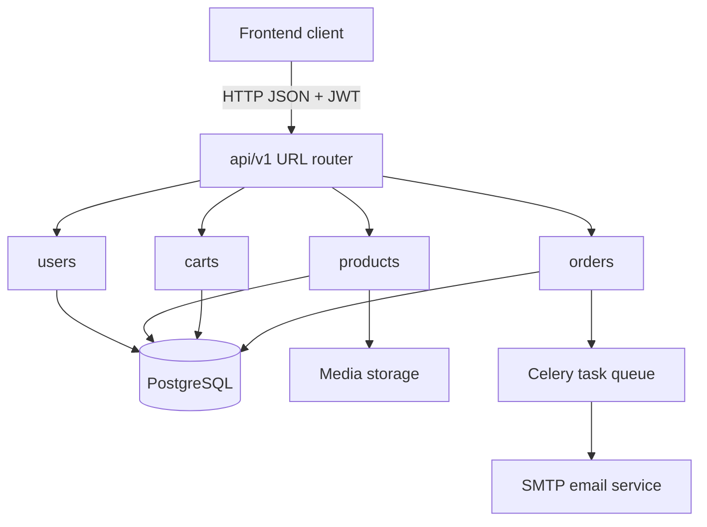

# ClickMart: E-Commerce REST API

Backend API for a shopping application built with Django and Django REST Framework. The service provides email-based user accounts, JWT authentication, product browsing, shopping carts, and order checkout.

## Features

- Custom user model with unique email login
- JWT access and refresh tokens
- Product catalog with stock, pricing, tax, and image support
- Authenticated cart management
- Checkout flow with stock validation and order snapshots
- Order notification emails through SMTP
- Django admin for users, products, carts, and orders
- PostgreSQL database support
- React/Vite storefront in `frontend/`
- Atomic stock-safe checkout with row locking
- Celery order notifications with retry handling
- Request throttling and rotating, blacklisted refresh tokens

## Architecture



### Application boundaries

| App | Responsibility |
| --- | --- |
| `clickmart_main` | Django settings, WSGI entry point, admin and API routing |
| `api` | Versioned API URL aggregation under `/api/v1/` |
| `users` | Custom user model, registration, profile, and JWT authentication integration |
| `products` | Active product catalog, images, prices, tax rates, and inventory |
| `carts` | One cart per user, cart items, totals, and quantity changes |
| `orders` | Checkout, stock reduction, order history, order details, and notifications |

### Request flow

1. A client registers or obtains a JWT pair through `users` endpoints.
2. The client sends the access token as `Authorization: Bearer <token>` for protected requests.
3. Products are read from the active catalog.
4. Authenticated users add products to their cart and adjust quantities within available stock.
5. Checkout copies cart totals and product prices into an order, decreases stock, clears the cart, and sends an email notification.

## Technology Stack

- Python
- Django 5.2
- Django REST Framework
- Simple JWT
- PostgreSQL via `psycopg2-binary`
- Pillow for image fields
- `django-cors-headers`
- `python-decouple` for environment configuration

## Project Structure

```text
backend-drf/
├── api/                 # Versioned API route aggregation
├── carts/               # Cart and cart-item domain
├── clickmart_main/      # Django project configuration
├── orders/              # Checkout and order domain
├── products/            # Product catalog and inventory
├── users/               # Custom user and profile domain
├── manage.py
├── requirements.txt
├── .env                 # Local only; never commit
└── README.md
```

## Local Setup

### Prerequisites

- Python 3.11 or newer
- PostgreSQL 14 or newer
- A database and database user with permission to run migrations

### Installation

From the `backend-drf` directory:

```powershell
python -m venv env
.\env\Scripts\Activate.ps1
python -m pip install --upgrade pip
pip install -r requirements.txt
```

On macOS or Linux:

```bash
python3 -m venv env
source env/bin/activate
python -m pip install --upgrade pip
pip install -r requirements.txt
```

### Environment variables

Create a local `.env` file. Do not commit it.

```dotenv
SECRET_KEY=replace-with-a-long-random-secret
DEBUG=True
DB_NAME=clickmart
DB_USER=postgres
DB_PASSWORD=replace-with-your-password
DB_HOST=127.0.0.1
DB_PORT=5432
EMAIL_HOST_USER=your-smtp-user@example.com
EMAIL_HOST_PASSWORD=your-smtp-password
```

The application reads these values with `python-decouple`. In production, use a secret manager or deployment platform environment variables and set `DEBUG=False`.

### Database and server

```bash
python manage.py migrate
python manage.py seed_products
python manage.py createsuperuser
python manage.py runserver
```

The development server runs at `http://127.0.0.1:8000/`.

### React frontend

In a second terminal:

```powershell
cd frontend
npm install
npm run dev
```

The storefront runs at `http://localhost:5173/` and uses `VITE_API_URL` when set,
defaulting to `http://127.0.0.1:8000/api/v1`.

For asynchronous order email delivery, start a Redis broker and a Celery worker:

```powershell
celery -A clickmart_main worker --loglevel=INFO
```

## API Reference

Base URL: `http://127.0.0.1:8000/api/v1/`

| Method | Endpoint | Auth | Description |
| --- | --- | --- | --- |
| `POST` | `/register/` | Public | Create a user account |
| `POST` | `/token/` | Public | Obtain access and refresh tokens |
| `POST` | `/token/refresh/` | Public | Refresh an access token |
| `GET`, `PATCH` | `/profile/` | JWT | Read or update the current profile |
| `GET` | `/products/` | Public | List active products |
| `GET` | `/products/<id>/` | Public | Retrieve an active product |
| `GET` | `/cart/` | JWT | Retrieve the current user's cart |
| `POST` | `/cart/add/` | JWT | Add a product to the cart |
| `PATCH`, `DELETE` | `/cart/items/<item_id>/` | JWT | Change or remove a cart item |
| `POST` | `/orders/place/` | JWT | Place an order from the current cart |
| `GET` | `/orders/` | JWT | List the current user's orders |
| `GET` | `/orders/<id>/` | JWT | Retrieve one of the user's orders |

Protected requests require:

```http
Authorization: Bearer <access-token>
```

### Example requests

Register:

```bash
curl -X POST http://127.0.0.1:8000/api/v1/register/ \
	-H "Content-Type: application/json" \
	-d '{"email":"shopper@example.com","username":"shopper","password":"change-me"}'
```

Add a product to a cart:

```bash
curl -X POST http://127.0.0.1:8000/api/v1/cart/add/ \
	-H "Authorization: Bearer <access-token>" \
	-H "Content-Type: application/json" \
	-d '{"product_id":1,"quantity":1}'
```

Place an order:

```bash
curl -X POST http://127.0.0.1:8000/api/v1/orders/place/ \
	-H "Authorization: Bearer <access-token>" \
	-H "Content-Type: application/json" \
	-d '{"shippingAddress":{"address":"10 Main Street","phone":"5551234567","city":"Austin","state":"TX","zipCode":"78701"}}'
```

## Testing and Quality Checks

Run Django's system checks and the application tests with:

```bash
python manage.py check
python manage.py test
```

## Deployment Notes

- Set `DEBUG=False` and configure `ALLOWED_HOSTS` before production deployment.
- Provide PostgreSQL and SMTP credentials through the deployment environment.
- Run `python manage.py migrate` during release deployment.
- Run `python manage.py collectstatic --noinput` when serving static files through a web server or CDN.
- Configure persistent media storage for uploaded product images.
- Serve the application through a production WSGI or ASGI server behind HTTPS.
- Keep `.env`, `env/`, database files, and uploaded media out of version control.

## License

No license has been specified yet.
